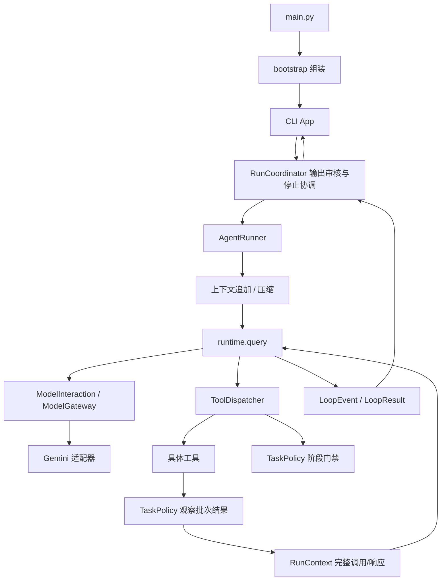

# 架构实现说明

本次实现依据 [framewokr.md](framewokr.md) 的“内核五模块 + 外核”划分。
该文件保留为原始设计依据；其中 HTTP 接口、服务持久化与部署部分按当前决策不再实现，
旧链路已经删除，不保留兼容入口。

## 一、划分与依赖方向

| 原划分 | 实现位置 | 职责 |
| --- | --- | --- |
| 运行时控制 | `kernel/runtime/` | Runner、最多 10 轮的循环、事件、停止检查点、按次绑定端口 |
| 上下文管理 | `kernel/context/` | 独立历史副本、inbox、运行通知、历史压缩 |
| 模型交互 | `kernel/model/` | ModelGateway 协议、流式消息、完整结果校验、用量累计 |
| 工具调度 | `kernel/dispatch/` | Tool 协议、工具筛选、调用 ID、审批指纹、并发与响应配对 |
| 任务策略 | `kernel/strategy/` | ExecutionPlan、阶段门禁、失败反思、修改验证、完成提醒 |
| 模型适配 | `adapters/gemini/` | Gemini 客户端生命周期、SDK 流转换 |
| 工具实现 | `adapters/tools/` | 文件、shell、联网、计划/反思、协作工具 |
| 协作系统 | `adapters/collaboration/` | 角色、独立子会话、引用/通信、权限衰减、后台任务清理 |
| 安全策略 | `adapters/security/` | 工作区检查、模型输出审核、运行停止协调 |
| 交互界面 | `adapters/cli/` | 终端输入、权限确认、流式渲染、会话内存 |
| 配置与组装 | `config/`、`bootstrap.py` | 读取配置，选择具体实现，注入内核 |

依赖原则是 **外部实现依赖内核契约，组装层连接两者**：
内核不读取全局 settings、不创建 Gemini 客户端、不导入具体工具或子代理管理器。
`AgentRunner` 必须显式取得模型、工具表与系统提示词；没有隐式默认工具表。
测试 `tests/unit/test_architecture.py` 用 AST 检查这条边界。

内核仍使用 `google.genai.types.Content/Part/Tool` 作为消息和声明 DTO，
以完整保留 function-call 与 thought signature。本次没有声称实现完全供应商无关的消息协议；
如果接入第二家供应商，可在模型端口处继续引入中立 DTO。SDK 请求、认证与配置已经在外核。

## 二、一次运行的数据流

1. CLI 把既有历史与用户输入交给协调器。协调器创建停止控制，并发进行生成和审核。
2. Runner 构造新历史，必要时经注入的模型端口压缩，不修改调用方原有历史。
3. 每次 query 新建上下文、策略、调度器和运行期绑定。计划/反思工具绑定到本次计划，
   协作工具绑定到本次子代理管理器，不跨运行共享可变计划。
4. 模型请求只携带有效工具声明：初始声明、注册表、允许表和本轮开始时的阶段限制共同生效。
5. 调度器生成唯一调用 ID，先产生 `tool.requested`，再审批和执行。
   审批必须匹配 ID、名称和参数指纹；未批准的修改工具返回错误，不执行。
6. 工具并发有界，单个工具异常转成失败结果，不丢弃同批其他响应。
   策略在整批完成后观察结果，避免“同批创建计划”掩盖其他工具的失败。
7. 上下文仅在调用与响应完整配对后建立检查点。模型继续执行、接受策略提醒或产生终态。
   运行上限不可通过大于 10 的参数绕过；子代理最终总结轮关闭工具。
8. 取消与流关闭会关闭嵌套流、取消并等待异步任务；运行绑定在 finally 中释放子代理。
   最终成功事件须等尾部审核通过，审核失败则返回经过清理的历史和失败终态。

## 三、子代理与工具绑定

`ToolBindingFactory` 实现内核的 `BindingFactory`：
复制工具表、绑定本次计划，并按需构造 `SubagentManager`。
内核只知道 `RunBindings(registry, usage, cleanup)`，不知道具体子代理类型。

子代理通过注入的 query 回调复用内核，持有独立历史和 inbox；工具集合是角色范围与父允许表的交集。
子代理移除 `subagent`，最大嵌套深度为一层。父运行退出会取消未结束的后台子代理。
explorer 保持只读；worker / monitor / default 不能绕过父阶段限制与逐次审批。

## 四、扩展入口

- **新增模型**：实现 `kernel/model/port.py` 中的 `ModelGateway.stream()/close()`，
  经 `create_runner(model=...)` 注入，不修改运行循环。
- **新增工具**：实现 `kernel/dispatch/base.py` 的 `Tool`，在
  `adapters/tools/index.py:create_tool_registry()` 中注册，或传入自定义工具表。
  可修改环境的工具必须设置 `read_only = False`；名称不能重复。
- **改变任务策略**：在 `kernel/strategy/policy.py` 中处理阶段、验证与完成判定，
  不在 CLI 或模型客户端里添加特殊循环分支。
- **新增交互方式**：消费 LoopEvent 并提供审批回调；目前只组装 CLI，
  不存在 HTTP 路由、数据库服务或旧路径兼容转发。

## 五、兼容性与未实现项

这是有意的目录/构造接口变更：旧 `core/`、`client/`、`tools/`、
`ui/`、`safety/` 导入路径已移除；库调用者应使用新契约或 bootstrap。

上下文压缩仍按消息数量触发。完成提醒仍为有限次纠偏，不等于测试驱动的强制完成证明。
工作区文件策略不约束已批准的任意 shell，线程工具也不是可杀死的进程沙箱。
CLI 历史仍仅存在内存中。输出审核与这些限制详见 [safety.md](safety.md)。
