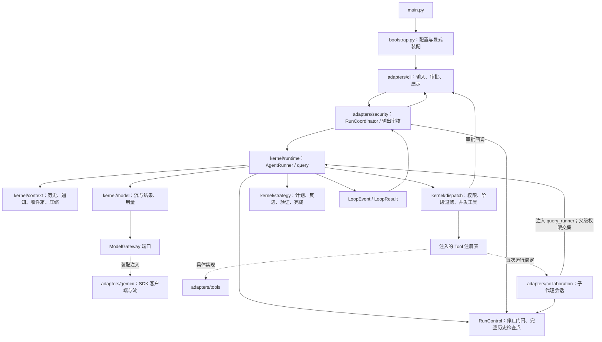

# CLI 运行链路

## 一轮用户输入

1. CLI 将内存历史和用户输入交给 Coordinator。
2. Coordinator 启动运行与输出审核，包裹审批回调；Runner 追加用户消息并按需压缩。
3. Runtime 按轮取得收件箱消息，策略确定阶段，调度器生成过滤后的工具声明。
4. 模型端口返回流式文本与完整结果；文本转成事件，调用 ID 补齐并去重。
5. 无工具调用时检查交付提醒；有调用时先审批，再并发执行并处理策略变化。
6. 函数调用与响应成对写入历史，再保存检查点；继续下一轮或到达 10 轮上限。
7. 正常终态等待剩余输出审核；阻断终态使用完整历史检查点。
8. CLI 保存返回的历史；退出时关闭 Runner 使用的模型客户端。

子代理共用底层模型适配器，但各自拥有历史、计划、收件箱和工具作用域；
可并行运行，不能递归创建子代理。角色、会话和上下文交接不属于 Runtime 内核。
`adapters/collaboration/bindings.py` 通过每次运行的绑定工厂注入这些能力。

此图中的适配器箭头表示装配后的调用关系，不表示内核反向导入适配器。
导入约束由 `tests/unit/test_architecture.py` 检查。没有 HTTP、数据库或持久化服务分支。
